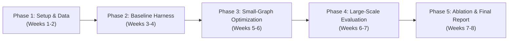

# Project Completion Plan: Harness Optimization for Graph Reasoning (CS 5624)

**Project Title:** *Harness Optimization for Graph Reasoning: Learn Small, Run Big*  
**Authors:** Bikash Kumar Paul, Abdullah Al Noman, Samin Rahman Khan, Md Zarzees Uddin Shah Chowdhury  
**Target Completion:** Early December 2026 (~7-8 weeks from proposal)

---

## 1. Executive Summary & Objective

The goal of this project is to determine whether an LLM agent harness or prompt skill optimized exclusively on small, computationally cheap graphs ($|V| \in [4, 50]$) can generalize to much larger graphs ($|V| \in [100, 2000]$), or if the learned strategies overfit to small-scale topologies.

---

## 2. Work Breakdown Structure (Phases & Deliverables)

### Phase 1: Environment, Dataset Pipeline & Ground Truth Solvers (Weeks 1–2: Oct 15 – Oct 28)
* **Objective:** Establish the testbed, repository structure, and data splits.
* **Key Tasks:**
  1. **Repo Setup:** Initialize Git repository with structured subdirectories (`src/`, `data/`, `experiments/`, `report/`), linting, and `.gitignore`.
  2. **Data Sourcing:**
     * Integrate **GraphArena** and **GraphQA** benchmark questions.
     * Implement a NetworkX-based generator to produce synthetic benchmark graphs at varying node scales:
       - **Small (Train/Val):** $N \in [4, 50]$ (Erdős–Rényi, Barabási–Albert, Watts–Strogatz).
       - **Medium (Test 1):** $N \in [100, 300]$.
       - **Large (Test 2):** $N \in [500, 1000]$.
       - **Stress Test (Test 3):** $N \approx 2000$.
  3. **Tasks & Verifiers:**
     * Define 3 fast polynomial tasks: Shortest Path, Connected Components, Cycle Detection.
     * Define 1–2 NP-hard / combinatorial tasks with small ground truth: Max Clique or Hamiltonian Path.
     * Implement deterministic ground truth verifiers using NetworkX and `pytest`.
* **Deliverable:** Working `data_loader.py` and `evaluate_answer.py` with reproducible data splits saved in JSONL format.

---

### Phase 2: Agent Sandbox & Baseline Evaluation (Weeks 3–4: Oct 29 – Nov 11)
* **Objective:** Build the runtime agent harness and benchmark baseline performance.
* **Key Tasks:**
  1. **Sandbox & Tool Registry:**
     * Develop execution environment: LLM interaction loop with Python code execution / NetworkX tool calling.
     * Ensure timeout limits and memory guards (critical when LLM generates code on 2,000-node graphs).
  2. **Baseline A (Unoptimized / Zero-Shot Harness):**
     * Minimal system prompt + raw tool definitions.
     * Benchmark Baseline A on both small and large graph splits.
  3. **Baseline B (Human Expert Hand-Crafted Harness):**
     * Hand-write best practice instructions: e.g., *"Always load the graph via NetworkX API calls; never iterate nodes textually; verify subgraphs before returning final answer."*
     * Benchmark Baseline B across all graph sizes.
  4. **Compute Infrastructure:**
     * Verify GPU access on Virginia Tech ARC (Advanced Research Computing) for open-weight models (e.g., DeepSeek-V4.1-Flash, GLM, or Qwen) or set up API fallback.
* **Deliverable:** Initial benchmark accuracy curves for Baselines A and B across all graph scales.

---

### Phase 3: Automated Optimization on Small Graphs (Weeks 5–6: Nov 12 – Nov 25)
* **Objective:** Run automated optimization on small instances to evolve the optimal harness $\mathcal{H}^*$.
* **Key Tasks:**
  1. **Optimizer Engine Selection & Implementation:**
     * Implement either **Meta-Harness** (code-level evolution of prompts + tool loop) or **SkillOpt / GEPA** (textual skill evolution via reflection).
     * Optimization loop:
       1. Run current harness $\mathcal{H}_t$ on a batch of small training graphs ($|V| \le 50$).
       2. Collect failure trajectories (syntax errors, timeouts, incorrect node paths).
       3. Critic LLM synthesizes lessons and outputs proposed edits to the harness $\mathcal{H}_{t+1}$.
       4. Evaluate on validation split; accept mutation if score improves.
  2. **Checkpointing & Run Tracking:**
     * Log evolution history (prompt changes, code changes, score progression) over $N=15-30$ rounds.
     * Save the highest-performing harness checkpoint $\mathcal{H}^*_{small}$.
* **Deliverable:** The frozen, optimized harness $\mathcal{H}^*_{small}$ and detailed optimization logs.

---

### Phase 4: Large-Scale Generalization Experiments (Weeks 6–7: Nov 26 – Dec 3)
* **Objective:** Test $\mathcal{H}^*_{small}$ on large unseen graphs and measure the Generalization Gap.
* **Key Tasks:**
  1. **Full Scaling Evaluation:**
     * Run $\mathcal{H}^*_{small}$ on Medium ($N=100$), Large ($N=500$), and Very Large ($N=2000$) graphs.
     * Compare head-to-head against Baseline A and Baseline B.
  2. **Metrics Computation:**
     * Task Accuracy vs. Graph Size ($|V|$).
     * Generalization Gap:
       $$\Delta_{\text{gen}} = \text{Score}(\mathcal{H}^* \mid \mathcal{D}_{\text{small}}) - \text{Score}(\mathcal{H}^* \mid \mathcal{D}_{\text{large}})$$
     * Token consumption and runtime latency per problem scale.
  3. **Cross-Model Transfer (Bonus / RQ4):**
     * Evaluate the best harness found by Model 1 on a secondary open-source model.
* **Deliverable:** Comprehensive results table, scaling curves (accuracy vs. $|V|$), and error classification logs.

---

### Phase 5: Qualitative Analysis, Ablations & Final Report (Weeks 7–8: Dec 4 – Dec 12)
* **Objective:** Analyze why rules transferred or broke, write the final paper, and package code.
* **Key Tasks:**
  1. **Rule-by-Rule Ablation:**
     * Inspect the diff of $\mathcal{H}^*$ compared to baseline.
     * Systematically disable discovered rules one-by-one on large graphs to identify which specific heuristics transferred vs. which caused failures.
  2. **Final Paper Writing (ACL Format):**
     * Revisit [main.tex](file:///c:/Users/princ/nlp/project_proposal/main.tex) to expand into the final report format.
     * Include: Introduction, Related Work, Formal Problem Setup, Experimental Results, Scaling Curves, Qualitative Analysis, Discussion, and Pangram-compliant human-written text.
  3. **Artifact Packaging:**
     * Clean and document GitHub repository, release benchmark generator and $\mathcal{H}^*$ prompts/code.
* **Deliverable:** Final submission PDF, slide deck/presentation, and public GitHub repository.

---

## 3. Team Role Assignments (4 Members)

| Role & Focus | Primary Lead | Responsibilities |
| :--- | :--- | :--- |
| **Data & Verifier Engineering** | **Member 1 (Bikash)** | GraphArena/GraphQA data ingestion; synthetic graph generator; exact solver ground truth verifiers (`pytest`). |
| **Agent Environment & Baselines** | **Member 2 (Noman)** | Python sandbox environment; NetworkX tool registry; execution timeout/resource monitors; Baselines A & B implementation. |
| **Optimization Loop (Meta-Harness/SkillOpt)** | **Member 3 (Samin)** | Optimization loop script; failure trajectory extraction; reflection prompts; ARC cluster compute coordination. |
| **Scaling Experiments & Ablation Analysis** | **Member 4 (Zarzees)** | Running test suites on 100–2,000 node graphs; metric calculations; rule ablation tests; visualization & plotting. |
| **Paper & Presentation (Shared)** | **All Members** | Collaborative drafting, error analysis, peer proofreading (ensuring zero AI-generated prose per course policy). |

---

## 4. Key Risks & Mitigation Strategies

| Risk | Impact | Mitigation Strategy |
| :--- | :--- | :--- |
| **Timeout on large graphs (2,000 nodes)** | Agent code hangs or exhausts context tokens | Enforce strict 30s code execution timeouts; provide NetworkX graph summary statistics in the prompt rather than full adjacency matrices. |
| **ARC GPU queue delays** | Stalled optimization runs | Use lightweight API models (or smaller 7B-14B models) for rapid local debugging; run large batch jobs overnight on ARC. |
| **Optimization collapse / Overfitting** | Skill optimizer generates rules valid only for small node labels (e.g. "nodes 0 to 5") | Validate each iteration on held-out small graphs with randomized node labelings before accepting a mutation. |
| **Pangram AI detector flags on final paper** | Grade penalty | All members write sections directly in LaTeX; maintain git commit histories proving human authoring progression. |
